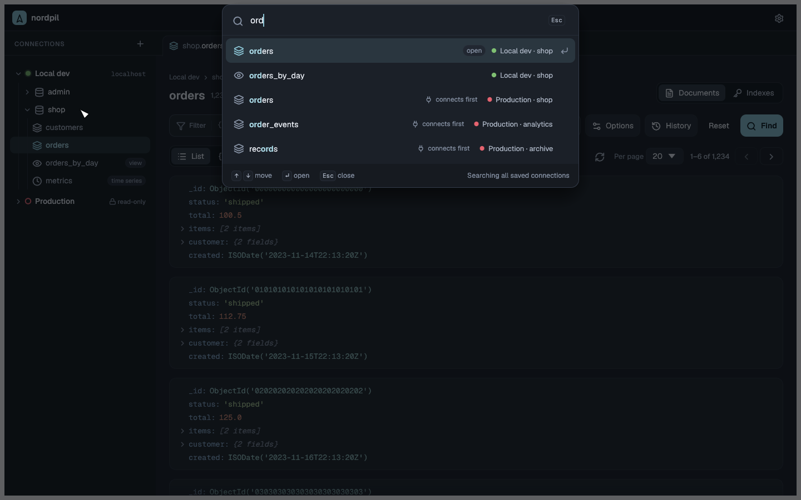
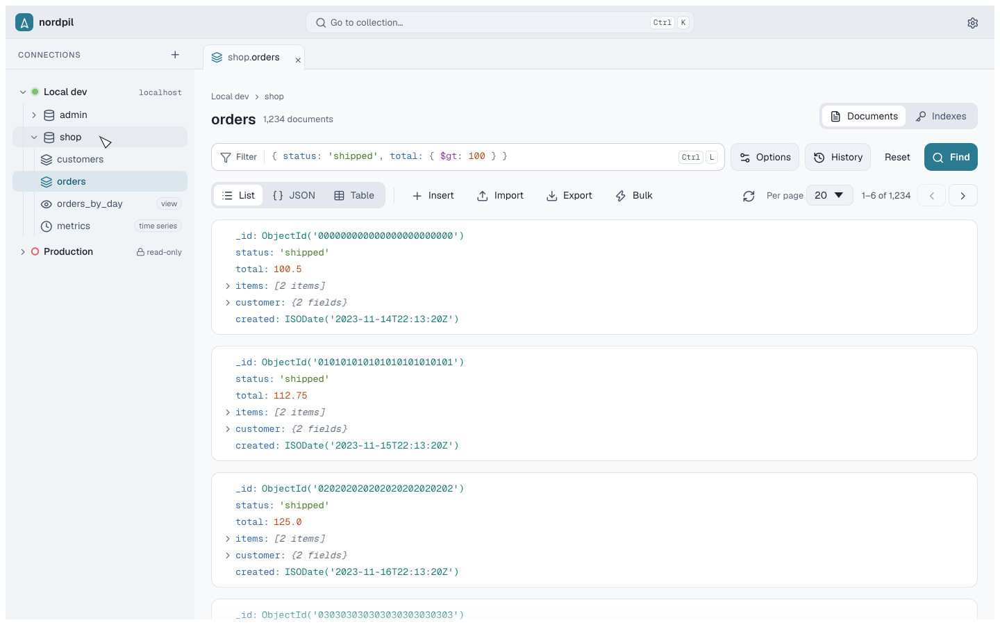
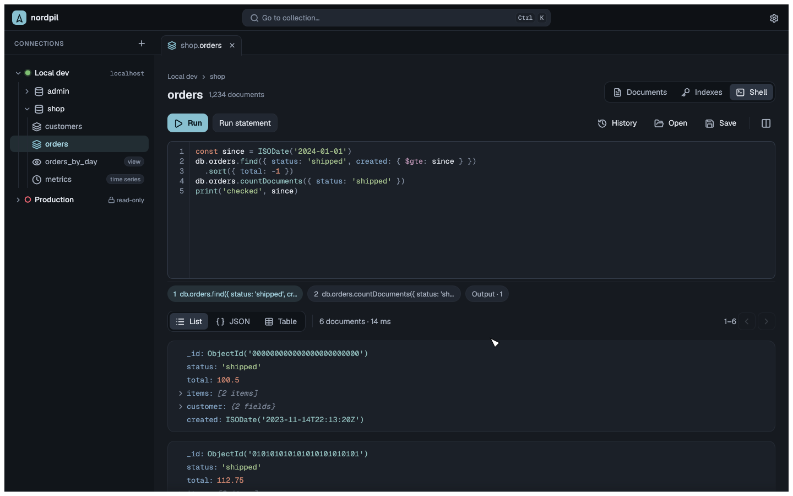

# nordpil

A lightweight, native MongoDB GUI written in Rust with [egui](https://github.com/emilk/egui).
It covers the everyday parts of MongoDB Compass in a fraction of the memory: about 75 MB
when idle, against roughly 1 GB for Compass.


## Features

- **Connections**: saved connections, edited as a connection string or as separate fields
  kept in sync. Passwords are stored in the system keyring, or asked for on each connect
  when there is none. Connections can be colored and marked read-only, which blocks every
  write.
- **Browse**: a tree of databases and collections (with views, time series and capped
  collections marked). Create and drop databases and collections.
- **Go to collection**: Ctrl+K finds any collection by name, recent ones first, across
  every saved connection; picking one on a closed connection connects to it first.
- **Query**: filters in mongosh syntax (`{ age: { $gt: 30 }, _id: ObjectId('…') }`) with
  highlighting and autocomplete for operators, constructors, field names sampled from the
  collection and values from the current results. Brackets and quotes close themselves,
  and operators such as `$in` insert their brackets. Ctrl+L focuses the filter. Project,
  sort, collation, hint, skip, limit and max time. Query history and favorites per
  collection.
- **View**: list, JSON and table views with paging and counts.
- **Edit**: insert, edit, clone and delete documents. Edits save only the changed fields
  and refuse to overwrite a document that changed since it was loaded. Bulk update and
  delete show how many documents match first.
- **Indexes**: keys, properties, size and usage; create, drop, hide and unhide.
- **Shell**: write mongosh-style JavaScript (`db.users.find({ age: { $gt: 30 } }).sort({ name: 1 })`)
  and run it, like Studio 3T's IntelliShell. Each statement's value gets its own result,
  shown in the list, JSON or table view with paging. Runs on an embedded QuickJS engine:
  no Node or mongosh needed. Covers reads, writes, cursors, the BSON types, `use` and
  `show`. The first write of a run asks first; read-only connections refuse writes.
  Ctrl+Enter runs the statement at the cursor, Ctrl+Shift+Enter the whole script.
  Autocomplete for collections, methods, fields and the script's variables. Drafts,
  history and favorites per collection; open and save `.js` files.
- **Import and export**: JSON, JSON lines and CSV, streamed with progress and cancel.
- **Settings**: dark, light or system theme, three text sizes, and whether Ctrl+K searches
  all saved connections or only open ones.

| Go to collection (Ctrl+K) | Values from the results |
| --- | --- |
|  |  |
| **Table view** | **Editing a document** |
|  |  |
| **Indexes** | **Light theme** |
|  |  |
| **Shell** | |
|  | |

## Install

Download a build from [Releases](https://github.com/LajnaLegenden/nordpil/releases):

- **macOS**: the `.dmg` for your Mac (`arm64` for Apple Silicon, `x86_64` for Intel);
  drag nordpil to Applications. The app isn't notarized, so run
  `xattr -dr com.apple.quarantine /Applications/nordpil.app` once before opening it.
- **Linux** (`x86_64` or `aarch64`): the `.deb` (`sudo apt install ./nordpil-….deb`), the
  AppImage (`chmod +x`, then run it), or the `.tar.gz` with `./install.sh`
  (`./install.sh --user` installs into `~/.local` without sudo).

Release builds update themselves: the AppImage, a `.tar.gz` install in a folder you can
write (like `~/.local`) and nordpil.app download and install a new release, then offer a
restart. A `.deb` or a system-wide install shows a link to the release instead. Choose
Install, Notify or Off under Settings → Updates.

Or build from source with Rust 1.97 or newer.

On Linux, install it system-wide with a launcher entry and icon. This builds a release as
you, then copies the files to `/usr/local` with sudo:

```sh
just install          # or another prefix: just install /usr
just uninstall        # same prefix as install
```

On other platforms, or for the binary only:

```sh
cargo install --path crates/app
nordpil
```

On Linux, saving passwords needs a Secret Service keyring (GNOME Keyring, KeePassXC, …),
and the file picker uses the XDG desktop portal.

Saved connections, settings, query history and recent collections live in the
platform config folder (`~/.config/nordpil/` on Linux); logs in the platform state
folder (`~/.local/state/nordpil/logs/` on Linux).

## Development

The workspace has four crates:

- `crates/query`: parses mongosh shell syntax into BSON and back, highlighting and
  autocomplete. No UI or database code.
- `crates/backend`: the database work on a background tokio runtime, saved connections,
  keyring access, import and export.
- `crates/shell`: runs shell scripts on embedded QuickJS. A JavaScript prelude provides
  the mongosh API; database calls go through a `Host` trait the backend implements.
- `crates/app`: the egui app.

`main` only changes through pull requests, merged by rebase. **CI** runs `cargo fmt`,
clippy, the unit tests and the Docker integration tests on every pull request that isn't a
draft, and it has to pass before merging.

Releases come from the **Release** workflow: run it from the Actions tab with the new
version. It checks and builds everything for that version first; only if all of it passes
does it commit the version bump to `main`, tag it and publish the release with the macOS
and Linux files. Tick "dry run" to only build the files, kept as one workflow artifact per
file. The packaging lives in `scripts/` (`package-linux.sh`, `package-macos.sh`,
`bump-version.sh`, `update-manifest.sh`) and runs locally too.

Each release carries `nordpil-update.json`, the SHA-256 of every file, signed with the
Ed25519 key in the `UPDATE_SIGNING_KEY` secret. The app installs only files listed in a
manifest that verifies against `crates/app/assets/update-key.pem`, for the version it
names. To replace the key, make a new pair with `openssl genpkey -algorithm ed25519`,
commit its public half (`openssl pkey -pubout`) there and update the secret; apps from
before the change stop updating until they're reinstalled.

Tasks use [just](https://github.com/casey/just):

```sh
just run          # start the app
just check        # formatting, lints and unit tests
just test-int     # integration tests against MongoDB in Docker
just screenshots  # render the UI to target/screenshots
```

## License

Licensed under either of

- Apache License, Version 2.0 ([LICENSE-APACHE](LICENSE-APACHE))
- MIT license ([LICENSE-MIT](LICENSE-MIT))

at your option.

The bundled [Geist](https://github.com/vercel/geist-font) fonts are under the SIL Open
Font License and the [Lucide](https://lucide.dev) icons under the ISC license; see
`crates/app/assets/fonts`.
