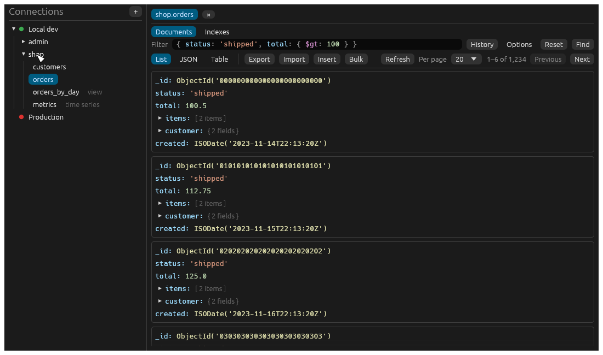
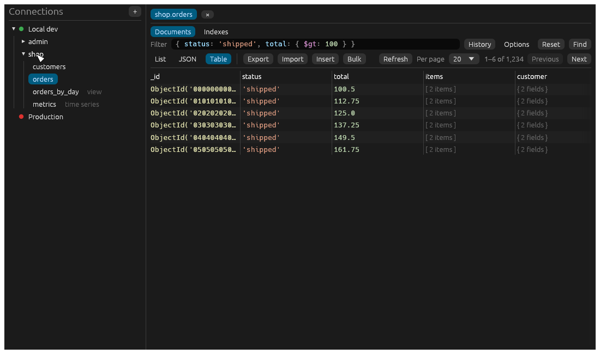
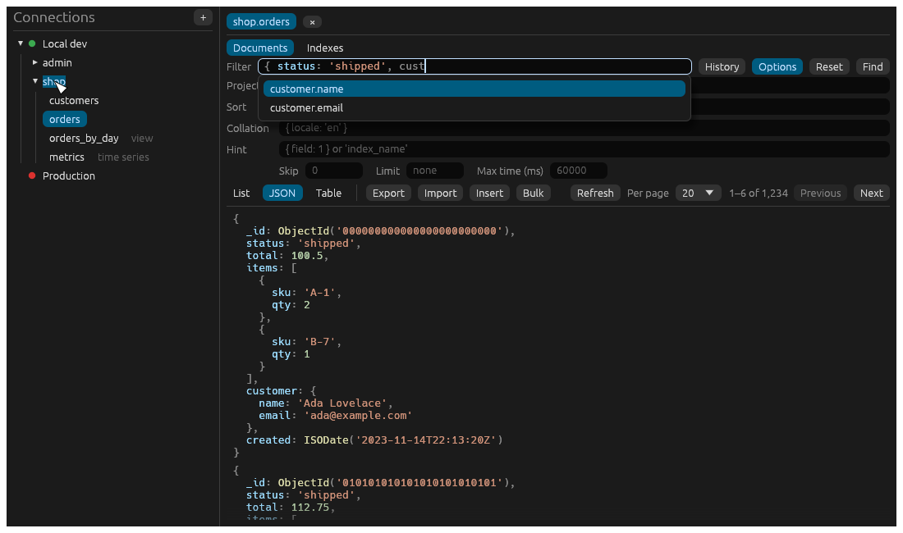
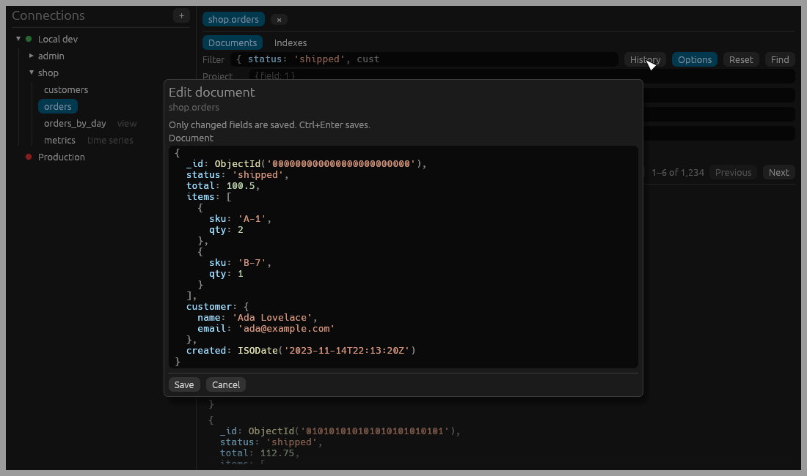
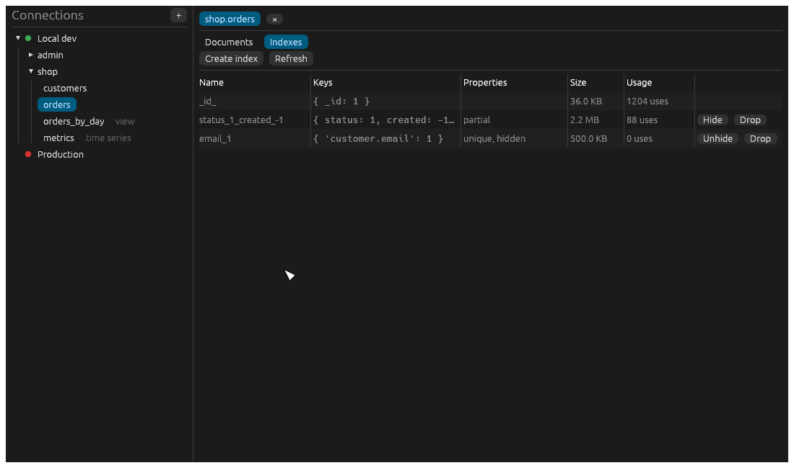

# nordpil

A lightweight, native MongoDB GUI written in Rust with [egui](https://github.com/emilk/egui).
It covers the everyday parts of MongoDB Compass in a fraction of the memory: about 75 MB
when idle, against roughly 1 GB for Compass.



## Features

- **Connections**: saved connections, edited as a connection string or as separate fields
  kept in sync. Passwords are stored in the system keyring, or asked for on each connect
  when there is none. Connections can be colored and marked read-only, which blocks every
  write.
- **Browse**: a tree of databases and collections (with views, time series and capped
  collections marked). Create and drop databases and collections.
- **Query**: filters in mongosh syntax (`{ age: { $gt: 30 }, _id: ObjectId('…') }`) with
  highlighting and autocomplete for operators, constructors and field names sampled from
  the collection. Project, sort, collation, hint, skip, limit and max time. Query history
  and favorites per collection.
- **View**: list, JSON and table views with paging and counts.
- **Edit**: insert, edit, clone and delete documents. Edits save only the changed fields
  and refuse to overwrite a document that changed since it was loaded. Bulk update and
  delete show how many documents match first.
- **Indexes**: keys, properties, size and usage; create, drop, hide and unhide.
- **Import and export**: JSON, JSON lines and CSV, streamed with progress and cancel.

| Table view | Autocomplete |
| --- | --- |
|  |  |
| **Editing a document** | **Indexes** |
|  |  |

## Install

There are no release builds yet. Build from source with Rust 1.97 or newer:

```sh
cargo install --path crates/app
nordpil
```

On Linux, saving passwords needs a Secret Service keyring (GNOME Keyring, KeePassXC, …),
and the file picker uses the XDG desktop portal.

Saved connections and query history live in the platform config folder
(`~/.config/nordpil/` on Linux); logs in the platform state folder
(`~/.local/state/nordpil/logs/` on Linux).

## Development

The workspace has three crates:

- `crates/query`: parses mongosh shell syntax into BSON and back, highlighting and
  autocomplete. No UI or database code.
- `crates/backend`: the database work on a background tokio runtime, saved connections,
  keyring access, import and export.
- `crates/app`: the egui app.

Tasks use [just](https://github.com/casey/just):

```sh
just run          # start the app
just check        # formatting, lints and unit tests
just test-int     # integration tests against MongoDB in Docker
just screenshots  # render the UI to target/screenshots
```

## License

Licensed under either of

- Apache License, Version 2.0 ([LICENSE-APACHE](LICENSE-APACHE))
- MIT license ([LICENSE-MIT](LICENSE-MIT))

at your option.
